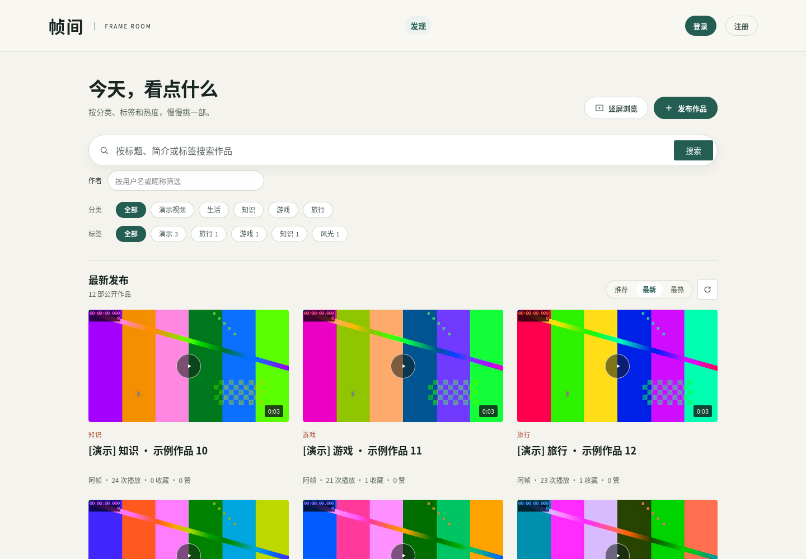
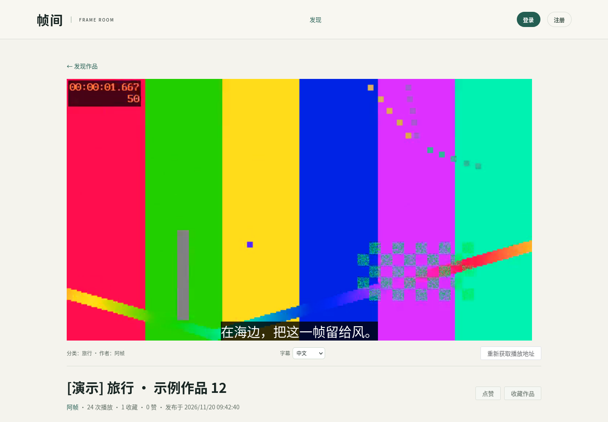
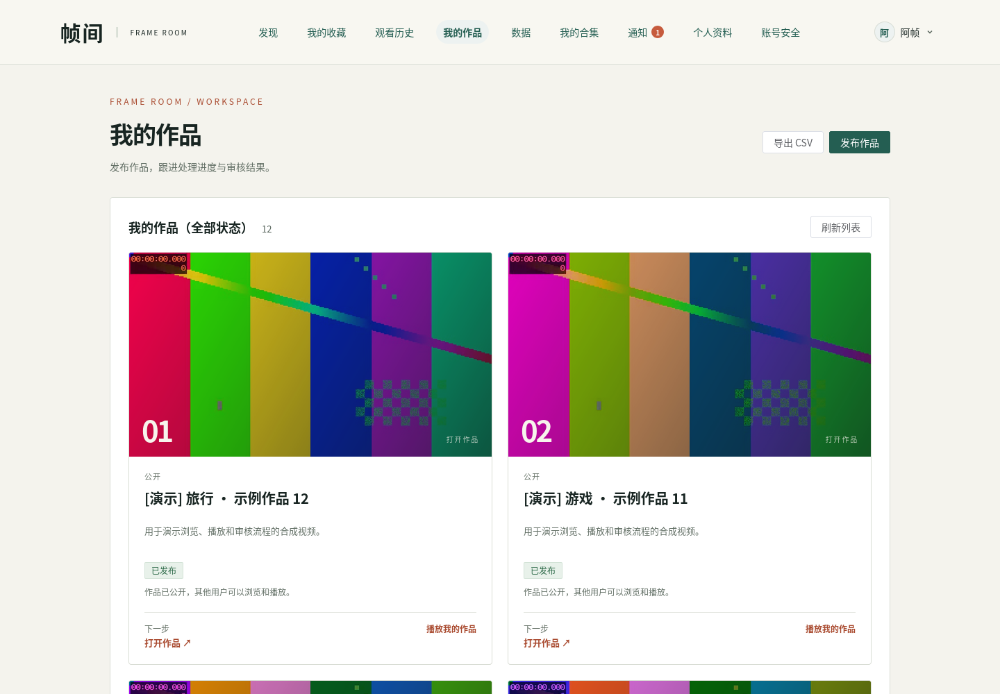
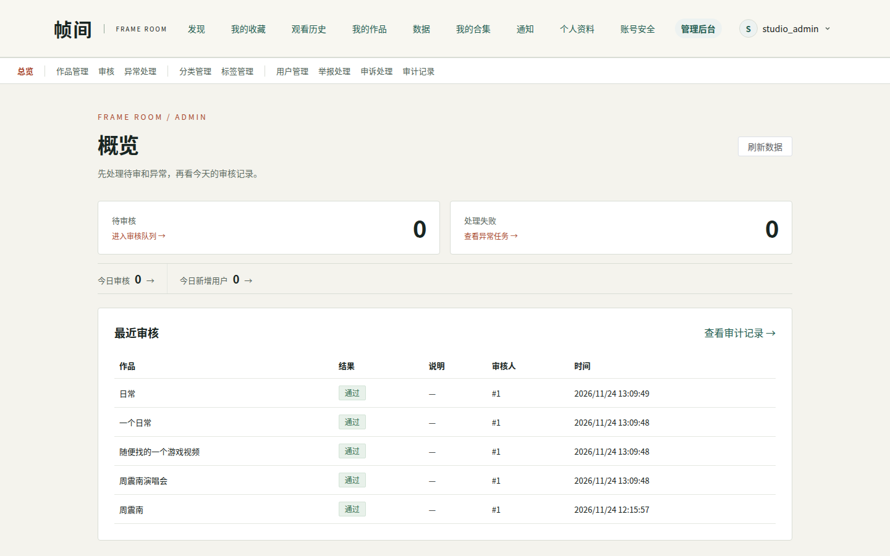
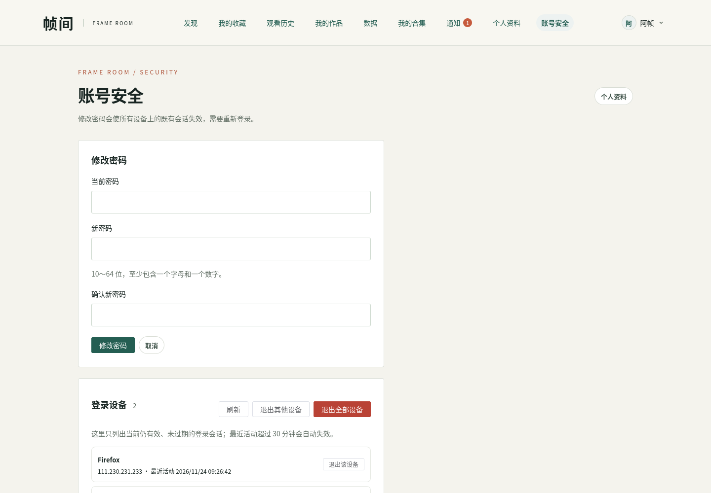
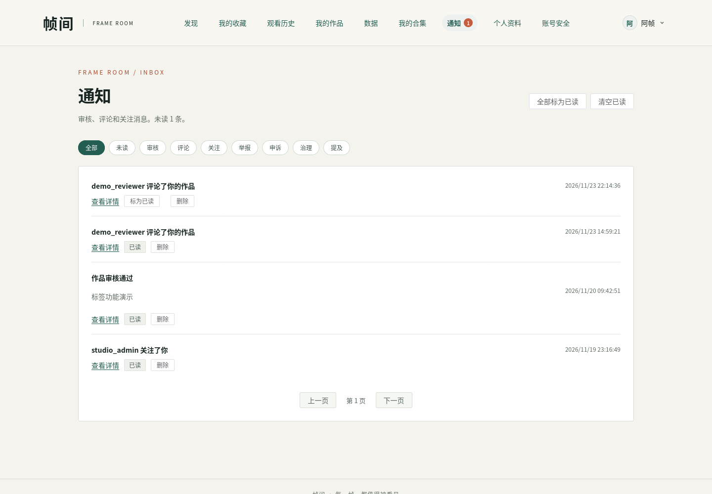
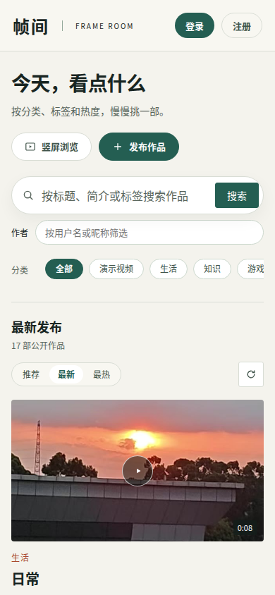

# 帧间

[](https://github.com/sude46/creator/actions/workflows/ci.yml)

一个面向视频创作者的 UGC 平台原型：创作者上传视频、平台转码与审核，观众公开浏览、播放、评论和收藏。

> 当前定位：**完整可运行的项目原型 / 作品集项目**，不是生产上线平台。项目边界见 [已知边界](#已知边界)。

## 截图

截图来自演示环境的合成示例数据。

| 首页 | 视频详情 |
| --- | --- |
|  |  |

| 创作中心 | 管理概览 |
| --- | --- |
|  |  |

| 账号安全 | 通知 |
| --- | --- |
|  |  |

移动端：



## 功能

### 公开发现

- 首页分类、标签、搜索和推荐
- 搜索建议：作品、标签、作者
- 竖屏 feed，支持最新、推荐、关注；默认尝试有声播放，浏览器阻止时降级静音并提示
- 视频详情、公开作者页、公开合集
- HLS 多码率播放，失败回退 MP4
- 5 种语言 WEBVTT 字幕，浏览器记忆字幕开关和语言
- 评论、回复、点赞、@ 提醒、收藏、关注

### 创作者

- 草稿与作品信息编辑
- 8 MiB 分片上传、逐片重试、文件指纹续传
- FFmpeg 处理状态、失败重试、取消处理
- 多码率 HLS、5 种语言字幕
- 送审、撤回、上下架、本人预览和下载
- 合集管理、作品排序
- 作者数据看板：累计指标、近 7/30/90 天播放、Top 10

### 管理与治理

- 超级管理员 / 审核员 / 内容管理员范围
- 审核台、批量审核、作品封禁/解禁
- 举报处理、作品/评论申诉
- 分类、标签、用户、审计
- 历史作品 HLS 回填
- 操作审计和原因记录

### 账号与安全

- Session 登录、CSRF、角色鉴权
- BCrypt 密码、自助改密、管理员重置
- 数据库设备会话：设备列表、单设备退出、退出其他/全部设备
- 改密和管理员重置使目标账号全部会话失效
- 禁用账号、角色变化即时失效

## 技术栈

| 层 | 技术 |
| --- | --- |
| 后端 | Java 21、Spring Boot 3、Spring Security、MyBatis / MyBatis-Plus、Flyway |
| 数据库 | MySQL 8.4 |
| 消息 | RabbitMQ |
| 媒体 | FFmpeg / FFprobe |
| 对象存储 | 腾讯 COS；MinIO 兼容实现 |
| 前端 | Vue 3、TypeScript、Element Plus、Vite、hls.js |
| 测试 | JUnit 5、MockMvc、H2、真实 MySQL / RabbitMQ / FFmpeg / MinIO / COS |
| 部署 | Docker Compose、Nginx、API 与 Worker 分进程 |

## 架构

```text
Browser
  │
  ├── Nginx / Vue 静态资源
  │
  └── Spring Boot API
        ├── MySQL
        ├── RabbitMQ
        ├── COS / MinIO
        └── 媒体任务
                 │
          Spring Boot Worker
                 ├── RabbitMQ
                 ├── MySQL
                 ├── COS / MinIO
                 └── FFmpeg / FFprobe
```

- 模块化单体，按 `identity`、`catalog`、`video`、`admin`、`audit` 分包。
- API 负责 HTTP、鉴权、业务事务、上传准入和媒体签名。
- Worker 负责消费媒体任务、FFmpeg 处理、封面/HLS 上传和结果绑定。
- 上传绑定、审核、发布、评论等状态由明确用例管理；Controller 不直接访问 Mapper/SDK。

详细说明见 [架构设计](docs/architecture.md)。

## 快速开始

### 环境要求

- JDK 21
- Maven 3.9+
- Node.js 22.14+
- Docker / Compose（用于 MySQL、RabbitMQ）
- 完整媒体链路需要对象存储（COS 或 MinIO）和 FFmpeg

### 1. 启动基础设施

```bash
cp .env.example .env
# 修改 .env 中的数据库和 RabbitMQ 密码
docker compose --env-file .env -f deploy/compose.yml up -d
```

本地 MySQL 监听 `127.0.0.1:3307`，RabbitMQ 管理页为 `http://127.0.0.1:15672`。

### 2. 启动后端

```bash
cd backend
export DB_PASSWORD='与 .env 中 MYSQL_PASSWORD 一致'
mvn -s maven-settings.xml -Dmaven.repo.local=../.local/m2 spring-boot:run
```

完整上传/播放还需要配置对象存储、媒体签名和 Worker，见：

- [上传与对象存储](docs/upload-storage-setup.md)
- [公开媒体与签名](docs/public-media-api.md)
- [媒体 Worker](docs/processing-worker-setup.md)
- [任务派发](docs/processing-dispatch-setup.md)

### 3. 启动前端

```bash
cd frontend
npm ci
npm run dev
```

打开 `http://localhost:5173`。前端开发代理 `/api` 到本机 `8080`。

### 完整 Compose

`deploy/compose.prod.yml` 提供 API、Worker、Web、MySQL、RabbitMQ 的生产型拓扑，对象存储需要单独配置：

```bash
cp .env.example .env
# 配置数据库、RabbitMQ、STORAGE_*、MEDIA_PUBLIC_ENDPOINT、ADMIN_*
docker compose --env-file .env -f deploy/compose.prod.yml up -d --build
```

Compose 默认给服务配置 Docker `json-file` 日志轮转：单文件 50 MiB，保留 3 个文件，避免长期运行日志无限增长。

在线演示（HTTP，仅用于作品集查看）：

```text
http://111.230.231.233:8080/
```

## 演示账号

| 账号 | 角色 |
| --- | --- |
| `studio_admin` | 超级管理员 |
| `demo_author` | 作者 |
| `demo_reviewer` | 审核员 |
| `demo_moderator` | 内容管理员 |

演示密码不写入仓库，请向作者获取。

演示数据由 `deploy/seed-demo.py` 通过真实 HTTP API 生成，不使用数据库直写：

```bash
export DEMO_ADMIN_PASSWORD='管理员密码'
export DEMO_AUTHOR_PASSWORD='作者密码'
python3 deploy/seed-demo.py --base-url http://127.0.0.1:8081 --count 12
```

## 测试

```bash
cd backend
mvn -s maven-settings.xml -Dmaven.repo.local=../.local/m2 test

cd ../frontend
npm ci
npm run build
```

当前基线：

```text
H2：252 项，0 失败/错误，11 项真实依赖测试跳过
真实依赖：MySQL 8.4.3、RabbitMQ 4.0.5、FFmpeg、MinIO、COS
252 项，0 跳过，0 失败
```

真实依赖测试使用独立测试数据库和临时账号，不连接演示业务数据。测试覆盖权限、CSRF、上传补偿、处理租约、审核并发、HLS、字幕、设备会话、对象存储签名和媒体处理。

## 已知边界

- 不是生产上线平台；没有 DNS/ICP/TLS/COS CDN/备份/监控/容量验收。
- 单 API 实例；多实例仍需粘性会话或 Spring Session。
- 没有 2FA、忘记密码、邮箱/手机验证、账号注销、数据导出。
- 搜索是多字段 `LIKE`，不是全文检索引擎。
- HLS 历史回填需管理员触发，没有自动全量扫描和百分比进度。
- 没有 DRM、手动清晰度、视频裁剪拼接、AI 生成、移动 App。
- 字幕/头像存 MySQL BLOB；上量应迁对象存储。
- 通知在业务事务内同步写入，生产可演进为 outbox。
- 具体剩余项见 [未完成清单](docs/remaining-work.md)。

## 文档

- [架构设计](docs/architecture.md)
- [项目案例](docs/portfolio.md)
- [未完成清单](docs/remaining-work.md)
- [上传与对象存储](docs/upload-storage-setup.md)
- [公开媒体与签名](docs/public-media-api.md)
- [作者视频接口](docs/creator-video-api.md)
- [审核接口](docs/video-review-api.md)
- [上下架与封禁](docs/publication-moderation-api.md)
- [媒体 Worker](docs/processing-worker-setup.md)
- [任务可靠投递](docs/processing-dispatch-setup.md)
- [安全与性能复查](docs/security-performance-review.md)
- [浏览器端到端验收](docs/browser-e2e.md)
- [部署与验证](docs/deployment-and-verification.md)
- [前端视觉方向](docs/frontend-visual-direction.md)
- [README 历史存档](docs/history.md)
