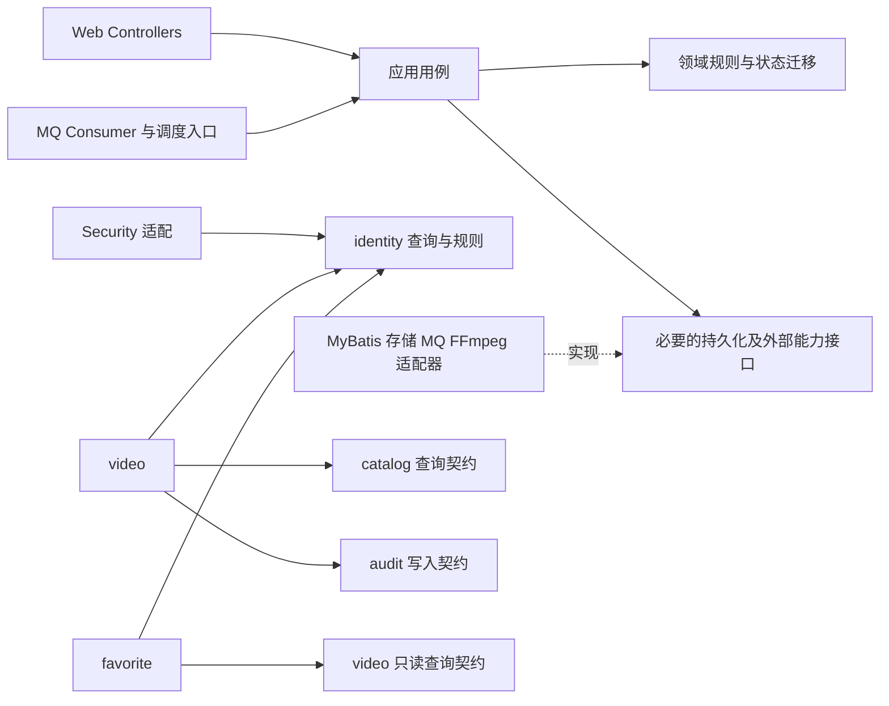
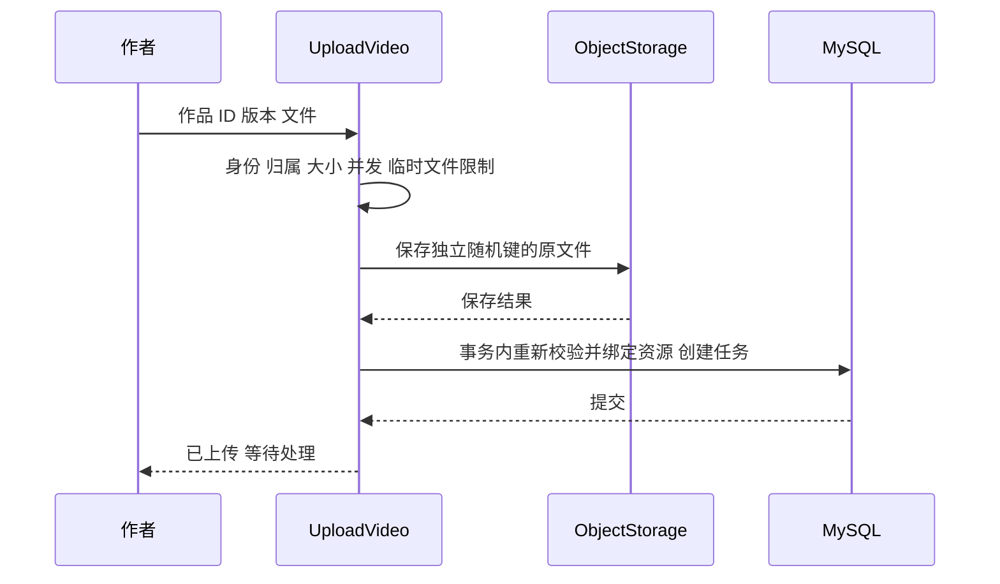

# 后端详细设计与审核清单

本文细化后端实现约束，供代码审核和后续模块开发使用。现有代码已完成账号、分类管理、草稿、上传、可靠投递、媒体 Worker、作者重试、审核、公开查询、媒体授权及上下架/封禁后端；真实媒体播放验收与未标注落地的设计契约需分别核对，不能视为已经实现。原需求文档继续保留在本地，不纳入 Git。

### 任务投递实现记录（2026-11-17）

上传事务内持久化任务；DispatchService 定量扫描，DispatchTransactions 在短事务中领取租约和写回结果，TaskPublisher 隔离 RabbitMQ 适配。发送与等待确认不持有业务事务；领取与完成均以任务状态、到期时间及派发令牌作条件更新。ACK 且没有 return 才记为发送确认，失败退避，崩溃后租约到期重投；已确认但持续 PENDING 的任务也会到期重投。

队列容量、TTL、死信保留、连接/线程和等待有明确上限；调度器使用独立线程，在应用启动完成后运行。发送仅改变派发元数据，不改变视频处理、审核或发布状态。当前提供至少一次运输；后续 Worker 以执行令牌和本地事务保护重复消费，仍不声称端到端恰好一次执行。配置与边界详见 [可靠投递说明](processing-dispatch-setup.md)。

### 媒体 Worker 实现记录（2026-11-17）

worker profile 独立启动且不开放 Web 服务；API 无媒体进程。ExecutionTransactions 通过 ExecutionRepository 边界领取、完成、失败与恢复，持久化实现位于 messaging；ProcessingWorker 编排事务外下载/处理/上传，ProcessingStorage 和 MediaProcessor 分别隔离 MinIO 与原生进程。执行租约、当前代次、有效令牌及封面登记共同保护提交，资源、元信息、任务成功和 READY 同事务；迟到结果不能重新绑定。

V6 增加执行租约、最多三次执行的自动重试、媒体元信息和 processing_output 清理登记。每次执行专属封面键在上传前登记，清理与完成对登记互斥，提交结果未知时不直接补偿删除。消息非法或基础设施异常进入有界死信，数据库事实和到期扫描恢复，避免无限立即 requeue。FFprobe/FFmpeg 有格式白名单、线程、输出和时间预算，环境不继承凭据；当前尚未验证操作系统沙箱，公网媒体处理上线前仍须落实部署隔离。

H2 和独立 MySQL 8.4.3 两轮完整测试各 104 项通过，包含真实 RabbitMQ 与 FFmpeg、非 Web Worker 消费到结果绑定、重复消息、旧令牌、失败回滚及封面清理；对象存储为 SDK HTTP 合约或故障注入适配器，真实 MinIO、JDK 21 实际运行、生产隔离及容量测试仍待完成。自动重试没有创建新 generation；后续作者手动重试用例负责创建新代次。配置与运行边界见 [Worker 说明](processing-worker-setup.md)。

### 作者处理查询与手动重试（2026-11-17）

CreatorVideoService 提供本人全部作品查询和暂时性终结失败的手动重试。CreatorVideo 聚合可重试规则；CreatorVideoRepository 隔离当前代次任务投影和条件更新。查询只暴露状态与受限错误类别，不泄漏对象键或执行令牌。

重试复用上传的账号行锁和待处理配额，锁顺序为账号 → 作品/当前任务；Worker 不持有账号写锁，不引入反向锁顺序。新代次、版本、PENDING、新任务和审计同事务提交，旧消息和旧执行结果仍受 generation 约束。接口与既有未上传草稿接口分工见 [作者处理说明](creator-video-api.md)。

首版目标是模块化单体，使用 Spring Boot 内嵌 Tomcat。API 与 Worker 来自同一工程，以不同运行配置启动；Worker 不启动 Web 服务。模块通过 Java 调用协作，不通过内部 HTTP 相互调用。

安全与性能的补充要求、当前实现缺口、资源预算和验收目标见 [安全与性能设计优化](security-performance-review.md)。涉及上传前准入、认证计算和事务边界、Worker 隔离、队列容量等内容时以该补充说明细化原有链路，不将未完成的设计视作实现。

## 1 现有代码审查与整改顺序

### 审核实现记录（2026-11-17）

ReviewService 编排提交、撤回、READY 元信息编辑、管理员决定与受限历史查询；CreatorVideo 和 ReviewDecision 保持不依赖 HTTP 的状态/输入规则，ReviewRepository 负责持久化边界。V7 为作品追加轮次和发布时间，review_record 按作品/轮次唯一保存当时内容及决定。版本和轮次都由请求提供，不能自动替换成新值。

通过设置 APPROVED/PUBLISHED，驳回保留原因；编辑已发布作品同时撤下并重置审核，待审期间不可编辑。决定、内容快照及审计在一个短事务提交；作者撤回和管理员处理、双管理员处理通过行锁和条件更新竞争，失败方不留下记录。分类锁先于作品锁，Actor 账号锁先于分类锁；Worker 仍保持作品 → 任务，不在其中申请账号/分类写锁。具体契约和未实现的媒体预览边界见 [审核接口](video-review-api.md)。

真 MySQL 回归定位到驳回历史插入的分类外键隐式共享锁与通过流程分类显式锁的反向等待，已让驳回也在作品前锁定分类（允许停用）。最终真实 MySQL + RabbitMQ + FFmpeg 全量 132 项通过，无失败或跳过，含五次双管理员竞争；V7 实际执行通过。当前发布是数据库状态，尚不代表媒体预览、完整浏览器和播放链路验收。

基线提交为 `794de34`。已有测试证明部分账号行为正确，不能据此认定分层和全部异常场景都已完善。

| 现状 | 问题与影响 | 下一次账号重构要求 |
| --- | --- | --- |
| AuthController 直接访问 UserAccountMapper | HTTP 入口依赖持久化细节 | 当前用户查询交给 AccountQueryService，Controller 只接收 DTO 和返回视图 |
| SecurityConfig 内查 Mapper、写响应 | 装配、查询和响应处理混在一个配置类 | 提取有实际调用方的成功/失败处理器和统一 SecurityResponseWriter，配置类只装配 |
| IdentityService.create 接受任意 role 字符串 | 未暴露 HTTP 提权入口，但内部调用可绕过密码和角色边界 | 提供 registerUser、bootstrapAdmin 两个明确入口；公共创建逻辑私有化，入口统一验证 |
| 用户名、密码校验分布在 DTO、Service、Bootstrap | 初始化与注册可能形成不同规则 | DTO 负责请求结构；UsernamePolicy、PasswordPolicy 统一业务规则，初始化复用 |
| UserAccount 是 MyBatis 可变实体 | 可被任意 setRole、setStatus | 持久化对象留在 infrastructure，业务角色和状态使用枚举，响应 DTO 不暴露实体 |
| 安全过滤器每次按用户名读取完整账号 | 密码哈希被无必要读取，多处重复查库 | 登录查询含哈希；会话有效性查询只读 ID、角色、状态，生成当前请求 Actor |
| ApiExceptionHandler 捕获所有 Exception | 框架的 404、405 等可能被错误转成 500 | 单独处理框架异常和业务错误，兜底只处理未知异常，保留 requestId |
| 业务异常直接保存 HttpStatus | 业务规则绑定 HTTP | 使用业务错误码，HTTP 映射集中于 web 适配层 |
| 限流按请求扫描全部 IP 窗口，参数写死 | 热路径随 IP 数增加，测试难以隔离配置 | 参数配置化、注入 Clock、有界存储、定期或摊销清理；验证真实过滤器 429 行为 |
| /admin/overview 返回阶段性提示 | 是当前权限探针，不是实际管理业务 | 实际管理接口接入时替换并删除对应占位调用，不能长期遗留无业务用途接口 |

以上是代码已读到的具体问题及计划，本次设计提交不宣称已经修复。先完成账号模块重构与回归，再开始上传模块；不要在旧边界上不断叠加功能。

### 1.1 账号模块重构进度

2026-11-16 的后续实现已落地以下整改，原表保留作为基线审查记录：

- 账号代码分为 web、application、domain、infrastructure；Controller 不再读取 Mapper，持久化对象不再作为应用层和响应类型。
- RegisterUser 和 BootstrapAdmin 分离，移除接受角色字符串的 IdentityService.create。UsernamePolicy 与 PasswordPolicy 同时约束 HTTP、内部用例和初始化。
- AccountRepository 区分凭据查询与不含哈希的账号摘要查询；过滤器生成当前请求 Actor，当前用户接口复用它，不再重复读取完整账号。
- SecurityConfig 只装配过滤链和配置；SecurityHandlers、SecurityResponseWriter 负责协议响应，状态规则由应用/领域处理。
- BusinessException 使用纯错误码，HTTP 状态映射集中在 web 适配层；框架 404/405/415 不再被兜底转换成 500，数据库故障返回 503。
- 登录限流参数配置化并启动校验，窗口容量有界，过期按创建顺序清理，Clock 可注入；真实过滤链测试覆盖注册与登录共享配额和伪造转发 IP 无法绕过。
- 账号禁用和角色变化使旧会话失效；数据库暂时不可用时拒绝当前请求但不误报账号失效。

管理员概览仍是实际前端使用的阶段性权限探针，待管理业务接入时整体替换；本次不把它计为真实管理功能。真实 MySQL、JDK 21 运行和完整浏览器联调仍待验证，H2 测试不能替代这些验证。

后续账号资源加固已完成：AuthenticationWorkBudget 在真实认证 Provider 与注册/初始化之间共享实例级预算，超额拒绝而非无界等待；哈希不再包裹数据库事务，输入字节边界在认证查询前校验。21 项测试通过，保留 Session 及原有接口契约。

## 2 模块与依赖规则

### 2.1 模块归属

| 模块 | 唯一负责的数据和规则 | 对外提供 |
| --- | --- | --- |
| identity | 账号、凭据、角色、账号有效性 | Actor 查询、账号可用性、注册和账号管理用例 |
| catalog | 分类、排序、启停、分类名称规则 | 可选分类查询、分类是否允许新作品使用 |
| video | 作品、媒体资源绑定、处理任务、审核记录、发布生命周期 | 创作命令、媒体访问授权、公开查询、审核命令 |
| favorite | 用户与作品收藏关系 | 收藏命令、个人收藏查询 |
| audit | 管理操作的持久化与受限查询 | 管理用例事务内写审计记录 |
| shared | requestId、时间/分页基础类型、错误约定 | 不包含视频、角色等业务规则 |

视频处理和审核在业务上是作品生命周期的一部分，首版归 video 模块。它们可以拥有独立用例类、消息消费者和任务调度器，但不能成为各自拥有一套作品状态的平行模块。



禁止 video 依赖 favorite；作品删除不级联调用收藏模块，收藏列表根据作品状态显示不可用。video 不依赖 catalog 的管理用例；分类删除通过数据库约束处理引用冲突，避免 catalog 再调用 video 形成环。

引用中的分类可停用，不可直接物理删除。作品新增/变更分类时校验 enabled；停用不影响已有作品正常展示，这是首版明确语义。不要把“可供新作品选择”和“旧作品仍可显示”混为一谈。

### 2.2 包结构

```text
com.creator
  identity
    web                 Controller Request Response
    application         RegisterUser AccountQuery BootstrapAdmin
    domain              Role AccountStatus UsernamePolicy PasswordPolicy
    infrastructure      MyBatis 账号持久化与 Spring Security 适配
  catalog
    web application domain infrastructure
  video
    web                 创作 公开查询 审核管理 三类入口
    application
      command           上传 提交审核 审核 下架 删除
      query             公开列表 本人列表 审核详情
      processing        领取 执行完成 失败 恢复
      port              ObjectStorage MediaProbe CoverGenerator TaskPublisher
    domain              状态 枚举 迁移规则 可见性规则 任务结果
    infrastructure
      persistence       MyBatis 记录对象 Mapper 条件更新
      storage           对象存储适配
      messaging         MQ 发布 消费确认 拓扑配置
      media             FFprobe FFmpeg 进程适配
      scheduling        扫描调度 租约恢复 清理
  favorite
    web application infrastructure
  audit
    application infrastructure
  shared
    web error time
  bootstrap             启动与配置装配
```

这是职责地图，不是要求一次创建所有目录。一个用例出现时才落对应代码，简单收藏关系无需强造复杂领域实体。领域规则不依赖 Servlet、Spring Security、HttpStatus、MyBatis、RabbitMQ 或存储 SDK。

## 3 设计模式与使用条件

| 手段 | 具体落点 | 使用理由与边界 |
| --- | --- | --- |
| 应用服务 | RegisterUser、UploadVideo、DecideReview 等用例 | 编排权限、事务和协作；不包含 Controller 的协议转换 |
| 适配器 | MinioObjectStorage、FfprobeMediaProbe、FfmpegCoverGenerator | 隔离 SDK、进程参数和测试替身；当前只有一个实现也有真实外部边界 |
| 仓储 | 作品/任务的受限查询与条件更新 | 封装状态写入语义，禁止业务任意调用 BaseMapper.update；简单只读查询可直接用专用查询 Mapper |
| 策略 | VideoVisibilityPolicy、RetryPolicy、PasswordPolicy | 规则集中并可测试；规则只有一种时用具体类即可，不建立无意义的策略工厂 |
| 状态迁移表 | VideoTransitions、TaskTransitions | 枚举与明确动作维护合法流转；暂不引入几十个 State 子类 |
| 数据库可靠投递记录 | ProcessingTask 的派发状态 | 保证事务后可恢复投递；它是专门的任务账本，不冒充通用事件平台 |
| 乐观并发控制 | 作品 version、审核轮次、处理代次、执行令牌 | 各自解决不同竞争，不能用一个版本号含混替代全部机制 |
| 依赖注入 | 构造器注入业务依赖、Clock、配置 | 测试可控制；禁止 ServiceLocator、静态持有 Spring Context |

不为展示模式堆叠 AbstractService、BaseController、ServiceImpl 空壳、万能工厂、反射命令分发和通用审批引擎。接口用于稳定边界、替换外部能力或约束复杂持久化操作；普通只有一个实现的用例可直接是具体类。

设计模式的验收依据是职责与依赖是否改善，不是类名里是否出现 Strategy、Factory。

## 4 用例契约与代码责任

以下为方法契约草案，参数必须转换成类型明确的命令，不能使用 Map 传任意属性。

| 用例 | 输入 | 输出与唯一责任 |
| --- | --- | --- |
| RegisterUser.execute | 用户名、原始密码 | 创建普通账号；不接收角色 |
| BootstrapAdmin.execute | 受控启动配置 | 幂等初始化管理员，不给现有普通账号提权 |
| AccountQuery.current | Actor/当前账号 ID | 返回安全账号视图，不带密码哈希 |
| CreateDraft.execute | Actor、requestId、标题、简介、分类 | 创建本人草稿，唯一请求键防重复 |
| UploadVideo.execute | Actor、videoId、expectedVersion、文件流 | 暂存、保存对象并以短事务绑定源文件及任务 |
| RetryProcessing.execute | Actor、videoId、expectedVersion | 验证可重试错误并创建下一代任务 |
| SubmitReview.execute | Actor、videoId、expectedVersion | 完整性校验、增加轮次、进入待审 |
| WithdrawReview.execute | Actor、videoId、expectedVersion | 只撤回仍待审的当前轮次 |
| DecideReview.execute | Actor、videoId、expectedVersion、reviewRound、decision、reason | 审核状态与审核历史、审计同事务提交 |
| EditMetadata.execute | Actor、videoId、expectedVersion、允许编辑的字段 | 已通过作品改信息时取消公开并重置审核资格 |
| ChangePublication.execute | Actor、videoId、expectedVersion、具体动作、原因 | 自主下架、合规再发布或管理员封禁 |
| DeleteVideo.execute | Actor、videoId、expectedVersion、管理原因 | 软删除并使后续授权和任务提交失效 |
| AuthorizeMedia.execute | Actor、videoId、purpose | 验证公开播放/本人预览/审核预览/本人下载不同权限 |
| Favorite.add/remove | Actor、videoId | 幂等管理本人收藏，不接收 userId |

Actor 是从可信认证上下文生成的不可变类型，至少包含账号 ID、角色、账号有效性。请求中的 ownerId、role 等不用于构造 Actor。管理权限使用独立管理入口和明确授权，不能因角色是 ADMIN 就自动绕过所有作者规则。

Controller 只负责绑定与结构校验、取得 Actor、调用一个用例、转换响应；用例不接收 HttpServletRequest、MultipartFile 或 Principal。上传首版采用原始 MP4 请求体，web 层将其转成输入流与声明长度交给用例；不接收客户端文件名、路径或对象键。

领域错误使用枚举错误码和必要参数，不绑定 HTTP。web/security 适配层统一输出 `{code,message,fieldErrors,requestId}`。日志记录内部原因，响应不含 SQL、命令行、内部存储地址和堆栈。

## 5 状态规则与并发约束

### 5.1 三组状态的职责

- ProcessingStatus：PENDING、PROCESSING、READY、FAILED。回答文件能否使用。
- ReviewStatus：NOT_SUBMITTED、PENDING、APPROVED、REJECTED。回答当前内容是否通过审核。
- PublicationStatus：UNPUBLISHED、PUBLISHED、OFFLINE。回答作者是否选择公开以及当前展示状态。
- moderationBlocked：管理员限制，作者不能清除；deletedAt：删除标记，任何公开条件都不能绕过。

保留三组状态是因为“处理成功但尚未提交”“通过审核后作者下架”等状态确实不同。前端展示状态由后端组合得到，不再增加一个可独立修改的 overallStatus 字段。

### 5.2 必须由数据库最终保证的不变量

1. 一个作品首版只绑定一个原文件；失败重传使用新作品，不覆盖原文件。
2. PUBLISHED 必须对应 READY、APPROVED、未封禁、未删除；账号无效时也不得公开授权。
3. 只有待审的当前 reviewRound 能被决定一次；审核记录不可覆盖。
4. 修改已通过的内容后不能保留公开资格，必须重新审核。
5. 相同 videoId 和 generation 最多一个任务；同一任务同时最多一个有效执行租约。
6. 只有当前 generation 和 executionToken 可提交媒体结果。
7. 管理员解除封禁只解除限制，不自动恢复公开；重置为未提交后再次审核。
8. 同一用户同一作品最多一个收藏关系。

公开列表使用 SQL 过滤，详情和签名授权也使用同一组规则。策略单测与查询集成测试都验证规则，防止 SQL 和 Java 规则逐渐不一致。列表不能先查全量记录再在 Java 里过滤，否则分页和数据隔离都会出错。

### 5.3 并发字段的含义

| 字段 | 解决的问题 | 何时变化 |
| --- | --- | --- |
| video.version | 作者修改、下架、审核等竞争 | 每次相关作品写操作递增 |
| reviewRound | 迟到的上一轮审核请求 | 每次新提交审核递增 |
| processingGeneration | 旧处理任务结果污染重试 | 每次人工创建新一代处理任务递增 |
| executionToken | 同一代任务租约到期后旧执行者迟到 | 每次成功领取执行租约生成 |
| dispatchToken/dispatchLeaseUntil | 多调度实例抢派与确认迟到 | 每次领取投递资格生成并设置截止时间 |

审核更新示意：`WHERE id=? AND version=? AND review_status='PENDING' AND review_round=? AND deleted_at IS NULL`。受影响行数为零表示竞争失败或条件不满足，不能接着插入成功记录。

后台处理更新不机械使用作者页面看到的 version 作为执行令牌。作者修改文本可能递增 version，但并不应使合法的同文件媒体处理无法完成。处理完成按当前代次和有效任务令牌判断，并递增作品 version 通知客户端刷新。

## 6 每条业务链路

下列“事务”均指同一 MySQL 数据库本地事务。存储写入、消息发布、FFmpeg 执行不放进数据库长事务。每条链路的接口测试必须验证失败时没有部分成功数据。

### L01 注册

入口 → 结构校验 → UsernamePolicy 规范化 → PasswordPolicy → 编码密码 → 短事务插入固定 USER → 返回安全视图。

用户名统一小写，并保留数据库唯一约束处理并发注册；不以“先查不存在”代替唯一约束。密码只进入编码器，不进入日志、事件、响应和审计。超出 BCrypt 字节上限直接拒绝。

### L02 登录 会话 当前用户 退出

获取 CSRF → POST 表单登录 → 有界限流 → Spring Security AuthenticationManager → 登录专用凭据查询 → 校验账号状态与哈希 → 会话标识轮换 → 成功响应 → 客户端重新获取 CSRF。

受保护请求：会话认证 → 账号有效性查询 → 当前请求 Actor → 接口角色校验 → 用例所有权校验。账号禁用或角色改变后，后续请求使旧会话失效。已经执行中的请求不承诺瞬间取消，关键管理事务仍需检查其授权条件。

退出使用带 CSRF 的 POST，使 Session 失效并清 Cookie。401、权限不足 403、CSRF 失败分别有稳定错误码，不把数据库故障写成“密码错误”。

### L03 创建草稿与编辑

Actor → 校验内容及分类 → create 请求键去重 → 插入本人草稿。唯一索引 `(owner_id,client_request_id)`，重复键查询既有结果；相同键但不同创建内容返回 409，保存请求内容指纹支持判断。自动生成随机请求键，不能全用固定字符串。

编辑：读取作品 → 所有权/状态规则 → 根据 version 条件更新。待审时要求先撤回；处理期间允许编辑文本，但不能替换源文件。修改已通过作品时，在同一更新中下架并将审核状态改为 NOT_SUBMITTED。

### L04 上传并绑定源文件



上传前检查用于快速失败，绑定事务中的再次检查用于消除竞争。绑定条件包含未删除、归属、版本和 sourceAssetId 为空。两个并发上传只有一个绑定成功，另一份对象安排清理。

写对象失败：不创建处理任务；对象成功但绑定失败：保留预先持久化的上传凭据，宽限期后核对引用并清理；不在提交结果未知或存储请求刚超时时立即删除。事务提交结果未知：先查询作品状态，不删除可能已绑定的对象。HTTP 响应丢失：前端查询作品状态，不默认重传。

必须限制磁盘、流长度、真实接收字节数和读取时间，不信任 Content-Length。临时文件在 finally 清理，进程崩溃留下的文件由按年龄清理作业兜底。

### L05 任务可靠投递

上传事务插入 ProcessingTask → 调度器以条件更新领取派发租约 → 提交领取事务 → 事务外发布 RabbitMQ → publisher confirm 且未被退回 → 以 dispatchToken 标记派发成功。

队列/交换机持久化、消息持久化，配置 mandatory 和 confirm。confirm ACK 但消息被 return 不算派发成功。消息只含 taskId、videoId、generation、schemaVersion，不携带文件或凭据。

发布成功但状态未更新允许重发。租约到期可重新领取。已派发但超过领取期限仍未执行的任务也重新派发，不能只检查“是否曾经发送过”。数据库任务是恢复事实来源，MQ 是运输渠道。

### L06 消费与处理成功

解析消息和版本 → 查任务 → 原子领取执行租约 → 领取事务结束 → 拉取源文件 → FFprobe → 规格校验 → FFmpeg 截图 → 上传当前执行尝试专属封面 → 完成事务 → ACK。

领取失败时区分：已终结/旧代次/有效租约中的重复消息可 ACK；不存在或消息结构非法进入有界死信处理。租约中的重复消息 ACK 后，如果原 Worker 死亡，由到期恢复扫描负责重新派发。

完成事务先按固定顺序锁定作品行，再条件校验并更新任务，之后绑定资源并写 READY。条件同时验证未删除、当前 generation、有效 executionToken；媒体元信息、任务成功、作品 READY 一起提交。删除、重试、恢复等涉及同两行的事务也统一“作品 → 任务”顺序，减少死锁。

任务结果已提交而 ACK 丢失时，重复消费读取成功状态后 ACK。数据库不可用不能把成功结果 ACK 掉；租约扫描与重新投递在数据库恢复后接管。未绑定封面对象待清理，旧 Worker 不能覆盖当前已绑定对象。

### L07 失败 重试 租约恢复

异常 → RetryPolicy 分类 → 失败事务 → ACK 当前消息 → 到期调度重投。可重试错误进入 RETRY_WAIT，不可重试或超过次数进入 FAILED；原设计中的任务状态在落库时应明确为 PENDING、RUNNING、RETRY_WAIT、SUCCEEDED、FAILED、CANCELLED。

坏文件、不支持编码、超过规格属于永久失败；存储暂时错误、受限次数的进程异常属于可重试。初始总执行次数上限 3 次，包含第一次执行，不把“三次重试”与“三次执行”混用。退避由数据库 nextAttemptAt 控制，消费者不 sleep，不用无限立即 NACK。

租约恢复：发现到期 RUNNING → 先锁作品再校验任务令牌/截止时间 → 释放为 RETRY_WAIT 或标记失败 → 清除当前执行令牌 → 待派发。完成与恢复只能一方提交成功。

人工重试：本人 + FAILED + retryable + 没有活跃任务 → 同事务增加 generation、创建新任务、重置处理状态。自动重试仍用原 generation，每次执行更换 executionToken。

进程有硬超时和输出长度上限，租约覆盖处理上限及缓冲；未来放开长视频时才增加可靠续租。FFmpeg 使用参数数组，不经过 shell，不接受任意输入 URL；命令执行和进程清理位于适配器。

### L08 提交与撤回审核

本人 → READY → 内容完整 → 无封禁 → 非待审 → 校验 version → 同事务 reviewRound 加一并设置 PENDING。重放旧版本返回 409，不凭重复请求再开一轮。

撤回仅条件更新当前 PENDING 和 version。撤回与管理员审核竞争时只允许一方成功。审核接口必须提交其看到的 reviewRound 和 version，不能读取最新版本后替用户“自动修正”旧请求。

### L09 审核通过 驳回与发布

管理员 Actor → 禁止审自己的作品 → 校验待审轮次/版本/READY/未删除/未封禁 → 条件更新 → 插入 ReviewRecord → 插入 OperationLog → 事务提交。

通过同时设置 APPROVED、PUBLISHED 和 publishedAt；驳回设置 REJECTED、UNPUBLISHED，原因必填。唯一约束 `(video_id,review_round)` 作为第二道保护；两管理员竞争失败的一方返回 409，整笔事务不留下“已审核”记录。

驳回后作者编辑并重新提交，历史原因保留在历史记录中。审核对象是当时的内容版本，首版不支持已发布旧版继续播放同时审核新版。

### L10 下架 再发布 管理员封禁

本人下架：作品归属 + version → OFFLINE，保持审核结论，清空发布时间。未改内容再次发布：READY、APPROVED、未封禁、账号有效、version → PUBLISHED，记录此次发布时间。

管理员强制下架：ADMIN + 原因 + version → OFFLINE、moderationBlocked=true，同时写审计。解除封禁：ADMIN + 原因 + version → 清除封禁、保持下架、重置 NOT_SUBMITTED，必须重新提交审核。不能复用普通作者的 publish 用例绕过封禁。

本轮落地只治理完整 READY 作品，运行中任务的取消/恢复尚未实现，不对处理中作品开放封禁。接口、原因历史、事务/并发和回归范围见 [上下架与封禁](publication-moderation-api.md)。

### L11 首页 搜索 详情 播放

登录 → QueryService → SQL 统一公开条件 → 参数化关键词/分类/稳定分页 → 返回视图。标题 LIKE 的 `%`、`_` 转义；页大小和关键词长度配置上限。中文搜索首版接受小规模 LIKE，不提前接搜索集群。

详情再次验证公开条件。播放授权时重新判断，不以几分钟前的列表查询结果代替当前权限。ObjectStorage 仅在授权成功后签名，数据库只存 objectKey。

浏览器按 Range 获取文件，验证 206、Content-Type、CORS、外部可达域名和签名 Host 一致性。链接过期时客户端重新申请；下架后禁止新签名，已发出的链接在 TTL 内仍可能可用，这是首版明确限制。立即撤销需要受鉴权媒体网关，不能声称仅靠数据库下架即可撤销旧 URL。

### L12 本人预览 审核预览 下载与导出

AuthorizeMedia 用显式 purpose 枚举区别 PUBLIC_PLAY、OWNER_PREVIEW、REVIEW_PREVIEW、OWNER_DOWNLOAD。规则按用途判断，不提供 `skipPermission=true` 之类绕过参数。

本人下载要求归属和 READY；审核预览要求 ADMIN 和相应作品访问权限，不等于开放任意原文件导出。下载设置 attachment 与安全文件名。作品信息导出只查本人、限制行数并处理 CSV 公式注入，不包含对象密钥和内部错误。

### L13 收藏与收藏列表

添加：登录 + 当前公开可见 → 插入唯一关系，重复键视为成功。作品并发下架时，收藏关系可以留下，但不得继续展示隐藏信息或发播放地址；若要求“下架瞬间绝不新增关系”，才引入作品行锁，首版不为该非关键差异增加锁。

取消：只删除 Actor 对应关系，零行也成功。收藏列表根据当前作品与账号状态投影，不可用记录仅返回取消关系所需标识和占位，不泄漏最新私有标题、审核原因或媒体路径。

### L14 删除与资源回收

删除事务先锁/条件更新作品为软删除，再使相关活跃任务失效，记录管理原因。HTTP 请求不等待对象批量删除。Worker 的完成提交检查作品未删除，防止重新绑定和发布。

回收扫描：已删除超过宽限期或孤立资源 → 验证无业务引用、无有效任务租约、非近期上传 → 幂等删除对象 → 更新资源状态。删除失败保留重试信息。事务结果未知不能把“暂时查不到引用”当永久孤立，必须等待宽限期并重查。

删除与正在签发媒体地址仍存在时间窗口，签名 TTL 限制同 L11，不承诺立即撤销所有现有连接。永久回收后不承诺恢复，恢复依赖备份。

### L15 用户 分类与审计管理

管理用户：ADMIN → 字段白名单 → 有效性/唯一性规则 → 更新与审计同事务提交。角色提升首版无网页入口。禁用使后续会话和公开查询失效，不批量篡改每个视频的审核状态。

首版用户管理只允许创建、修改和禁用普通账号；拒绝修改管理员的角色、状态以及删除管理员，管理员凭据维护使用受控运维流程。这样不引入首版不需要的管理员治理能力。未来若开放管理员禁用，必须增加串行化守卫，例如相关事务先锁唯一 admin_guard 行再检查并更新，不能仅先 count 再 update 以免并发删除最后两个管理员。直接运维 SQL 不属于应用接口的保证范围。

分类：新增、改名、排序、停用、删除均通过 catalog 用例，名称唯一；存在作品外键引用时拒绝物理删除并返回业务冲突。审计只读，不为满足 CRUD 演示而开放篡改历史。

## 7 持久化与数据边界

- Flyway 迁移只追加，不修改已发布且执行过的迁移。下一步分别增加分类、作品/资源、任务、审核、收藏和审计表。
- 作品与分类、收藏与账号/作品等稳定引用使用外键 RESTRICT，不做级联物理删除。media_asset 引用 video，作品保存源/封面 ID 的反向绑定由事务保证，避免循环外键妨碍插入和迁移。
- processing_task 增加 dispatchToken、dispatchLeaseUntil、executionToken、leaseUntil、nextAttemptAt、schemaVersion 所需字段；使用唯一索引和扫描索引验证实际查询。
- media_asset.objectKey 唯一，保存技术元数据；签名 URL 不入库，上传原名不进入服务器路径。
- MyBatis 记录对象可以是可变 PO，但只留在持久化适配层；公开视图的 BIGINT ID 用字符串，时间统一约定 UTC。
- version 条件更新使用明确 SQL 和受影响行数，不用先读后无条件 updateById 冒充乐观锁。
- 审核和管理写审计需要同库事务原子性，不能只用提交后内存事件异步记录；非关键统计将来才可用提交后事件。
- 固定锁顺序：作品 → 任务 → 资源绑定；管理员守卫事务：admin_guard → 账号。外部调用一律不持有这些锁。

## 8 防止死代码和过度设计的规则

1. 每个生产类必须有真实业务入口或框架生命周期入口；未来功能的空实现不提交。
2. 新增接口要说明调用方、边界和错误契约。只为遵循命名习惯创建 XxxService/XxxServiceImpl 不构成理由。
3. 不保留 TODO 返回成功、固定列表假装查库、空 catch、永远返回 true 的权限判断、吞掉处理错误的成功 ACK。
4. 删除旧实现时同时删调用、配置、测试替身和过期文档；测试只保留旧代码引用不能证明旧代码仍有业务用途。
5. 一次模块提交只包含该模块必要代码和文档，不提前引入没有消费者的 Redis、工作流、推荐与支付 SDK。
6. 枚举值、限制、超时和重试次数有单一来源；环境参数用类型化配置并启动校验，避免散落魔法字符串。
7. SQL、对象存储键规则、FFmpeg 参数、RabbitMQ 路由名分别在自己的适配层集中维护，不散落 Controller。
8. 不用全局工具类藏业务 Service，不在实体 getter、JSON 序列化中偷偷查数据库或生成签名。
9. 查询用例不隐式改变业务状态；调度、清理和租约恢复有明确入口、日志与可关闭配置。
10. 静态分析和编译检查只能辅助发现死代码，框架入口与反射使用要人工核对，不以“搜索不到调用”直接删组件。

## 9 审核与验证要求

每个链路交付时同时给出入口、输入、权限、事务、条件更新、外部副作用、失败结果、幂等策略及实际测试结果。设计上写了某个恢复能力，不等于代码已完成。

| 审核维度 | 必须能回答的问题 | 验证方式 |
| --- | --- | --- |
| 分层 | Controller 是否访问 Mapper/SDK，领域是否依赖 HTTP | 源码检查；模块形成后加包依赖约束测试 |
| 权限 | 另一个用户、普通用户、禁用账号如何被拒绝 | 实际过滤链和接口集成测试 |
| 状态 | 哪些迁移合法，失败是否没有部分写入 | 迁移单测与数据库事务测试 |
| 并发 | 两请求竞争后哪一方成功 | 独立连接/线程协调测试，不能只顺序调用两次 |
| MQ | 发布失败、重复消费、ACK 丢失如何恢复 | 真实 RabbitMQ 与可控故障联调 |
| 存储 | 对象成功但 DB 失败、上传响应丢失怎么处理 | 存储适配契约测试与故障注入 |
| 进程 | 不支持编码、超时、异常输出、磁盘不足 | 真实 FFprobe/FFmpeg 小样本集成测试 |
| 查询 | 隐藏内容能否从搜索、收藏、详情绕过过滤 | 同一数据集覆盖所有读入口 |
| 清理 | 能否误删活跃资源、重复执行是否安全 | 租约与引用竞争测试 |
| 环境 | H2 成功后 MySQL 是否同样正确 | MySQL 真库迁移、索引和并发测试 |

账号重构优先补：领域规则不经 HTTP 也验证、通用角色入口消除、大小写用户名一致、真实过滤器限流、账号状态及角色变化、404/405 与业务错误映射。后续再根据实际模块建立架构测试，不提前增加没有代码可约束的工具依赖。

### 分类管理后端实施记录

链路为 Controller → CategoryService → CategoryRepository/MyBatis，分类名称规则独立于 HTTP。读取启用分类要求登录，全部管理入口在过滤链和应用用例均要求 ADMIN；Actor 来自当前请求的账号校验，不能由 JSON 指定。

创建使用规范键唯一索引处理并发重名，不依赖先查后写；修改/删除使用 `id + version` 条件更新。审计写入与分类修改共用短事务，不调用外部服务；审计失败整体回滚。乐观锁冲突返回 STALE_WRITE（409），客户端需重新读取后确认修改；删除成功后重试返回 404。创建暂不提供请求键幂等，响应丢失时应先查询结果再决定是否重试。

分页上限 50 条、页码上限 1000，排序为 sort_order、id，启用列表有对应复合索引。审计记录操作者、动作、目标及服务端 requestId，不保存凭据。名称规范键使用 VARBINARY 唯一索引，避免不同数据库默认排序规则影响唯一性。

分类删除的引用冲突由 V3 的真实作品外键保护，后续草稿集成测试已验证返回 CATEGORY_IN_USE；分类仍可停用。分类前端、审计查询/导出与清理策略尚未实现。分类阶段 28 项后端测试通过，其中 7 项分类集成测试覆盖权限、并发和审计事务回滚；H2 结果不能替代真实 MySQL 和压测。

### 作品草稿后端实施记录

当前入口为 `/api/creator/drafts` 的创建、本人分页、详情和编辑。DraftController → DraftService → DraftRepository；分类选择通过 catalog 的 CategorySelection 应用入口协作，不访问分类 Mapper 或管理用例。VideoMetadata 约束标题、简介、分类 ID，并以字段字节长度分隔的 SHA-256 保存规范化创建内容指纹。

读取和更新 SQL 都包含 owner_id，身份来自后端 Actor；管理员使用自己的创作入口也不能越权操作他人草稿，他人 ID 与不存在 ID 均为 404。更新同时要求 id、owner_id、version 和草稿状态条件，成功才递增版本并写审计。

V3 使用 processing_status、review_status、publication_status 三组状态及封禁/删除标记，不添加独立 overallStatus。草稿用例只创建 PENDING / NOT_SUBMITTED / UNPUBLISHED 且未封禁、未删除的记录；本人草稿查询/编辑只处理这组条件，创建重放也执行同一访问条件。V4 又增加 source_asset_id 为空的条件，已上传源文件不能再从草稿入口编辑或重放创建。数据库有公开状态基本组合约束，后续状态迁移、公开查询和授权仍未实现。处理期间文本编辑需按 L03 扩展创作者作品用例，不直接放宽草稿更新 SQL。

创建先按 owner_id + 规范 UUID 查重；已存在时比较不可变创建指纹，返回当前可读草稿，同键不同内容返回 409。不存在时锁定目标分类、校验启用、尝试 INSERT；最终仍由唯一索引防重复，不以预查询保证唯一。重复键后使用 FOR UPDATE 当前读获取已提交结果，避免 MySQL REPEATABLE READ 的早期快照看不到竞争者。创建审计仅由 INSERT 成功的一方写入，编辑不改变请求键与原始指纹；重复请求不触发第二次编辑或审计。

分类选择锁在作品写事务内持有至提交，保证并发停用/删除与新引用串行判定。锁只覆盖一条分类记录，无外部调用；相同热门分类的新建和更换分类会短暂串行，这是首版一致性取舍，需真库测量后评估共享锁优化。保留原分类编辑无需重新要求 enabled，停用不影响原关联。草稿写事务超时 5 秒，不代表端到端耗时已经实测达标；数据库故障/死锁由统一错误处理返回 503，可使用原创建键重试，不进行无界自动重试。

作品与审计共用本地事务；审计故障回滚作品、版本、请求键与已写入的审计。分页按本人 ID 倒序，限制 50 条/页和 1000 页，使用 owner_id + id 索引；总数查询仍可能随本人作品数量增长，暂未引入缓存。上传的后续实施见下一节；作品删除、处理、审核、播放和草稿前端尚未完成。

后端共 38 项测试通过，草稿新增 10 项实际 Spring/Mapper/过滤链测试，包含两个独立线程竞争创建/编辑、同键异内容竞争、越权、停用及引用约束、事务故障注入和重放的状态保护。测试使用 H2，真实 MySQL 的迁移、锁等待、隔离级别和索引行为仍待联调。

### 源文件上传后端实施记录

接口、默认预算和存储接入要求见 [上传与对象存储接入](upload-storage-setup.md)。UploadController → UploadService → UploadTransactions/UploadRepository，ObjectStorage 端口由 MinioObjectStorage 实现。上传关闭时没有上传路由、维护作业或对存储的启动访问；默认配置不依赖可用的 MinIO 服务。开启时验证桶私有、版本化 OFF 和未完成分片回收规则。

相较原 multipart 方案，首版改为 video/mp4 原始请求体并关闭自动 multipart 解析，原因是消除权限检查前自动落盘及表单 CSRF 回退触发解析的窗口。ActiveAccountFilter 提前至 CsrfFilter 前恢复并核验 Actor；上传准入通过 HttpSecurity Customizer 接入全局安全链，身份模块不依赖视频模块类。准入要求真实账号、PUT、明确 MIME 和 CSRF header，再取得本实例全局/每账号名额及临时磁盘预算；有效 token 仍由后续 Spring CSRF 过滤器校验，不能以“存在 header”代替验证。名额在整个同步请求结束时释放。

UploadTransactions.reserve 按账号 → 作品锁定，校验所有权、版本、源文件未绑定、草稿状态、逻辑配额和未回收凭据上限，持久化 UPLOADING 凭据及随机键。随后在事务外接收、初筛文件头、累计真实字节、检查截止预算并写对象。绑定事务仍按账号 → 作品 → 凭据锁定，重新核验身份/角色、版本、状态、配额和凭据有效期；源文件记录、作品绑定与版本、PENDING processing_task、BOUND 凭据和操作审计一并提交。处理任务目前只有持久化入口，RabbitMQ 发布/消费尚未实现。

同账号配额 SUM 在持有账号行锁后读取，所有源文件绑定均经过该锁，避免独立连接竞争突破配额；真正的 MySQL 隔离与锁等待仍须验证。源文件写入条件还含 id、owner_id、version、草稿状态、未删除/封禁及 source_asset_id 为空。一个作品仅一个 SOURCE 资源与一个 generation=1 任务，唯一索引作为最后防线。已绑定时返回 SOURCE_ALREADY_BOUND，响应丢失时应先 GET 本人上传状态，不默认创建新上传。

故障补偿采用持久化凭据 + 宽限期。UPLOADING/CLEANING 过期后，维护作业事务内锁定凭据并核对引用，再领取清理租约；删除在事务外进行，成功记 DELETED，失败留待租约到期重试。绑定要求凭据仍 UPLOADING 且未到期，因此清理与迟到绑定互斥。BOUND 或仍有资源引用的对象不删，已提交但响应异常不会触发误删；对象键不复用，重复删除孤立对象安全。远端未完成分片由桶的 1 天回收规则兜底，普通 DeleteObject 不能处理这类残留。

临时文件在各路径清理，进程崩溃残留按年龄回收且跳过活跃文件；接收和 SDK HTTP 预算、并发、大小与磁盘预留有界。低水位仅针对 API 临时文件系统，不能视为远端存储容量保护。原始视频未全量进入 JVM；不能据此声称堆峰值、120 秒精确硬截止或容量已压测达标。长期凭据归档、运维告警、生产代理、真实 MinIO 的分片异常与磁盘行为仍待落实。

最终后端 59 项测试通过，上传新增 14 项集成测试、3 项资源测试和 4 项真实 SDK HTTP 契约测试；包含真实嵌入式 Tomcat 的 Session/CSRF 原始文件请求、双线程绑定/配额竞争、存储与审计故障、提交结果异常、清理领取互斥、临时文件恢复、缺权限/CSRF 时 body 未读及跨 SDK HTTP 调用的整体时间预算。数据库为 H2，存储为故障注入适配器或本机契约端点，尚未完成真实 MySQL/MinIO、FFprobe 规格检查和浏览器联调。

### 公开查询与媒体授权后端实施记录

链路为 PublicVideoController → PublicVideoService → VideoQueryRepository/MyBatis；媒体为 MediaController → MediaAuthorizationService → VideoQueryRepository → MediaSigner/MinioMediaSigner。领域搜索与媒体用途不依赖 HTTP 或 SDK。公开 SQL 在列表、详情与签发共享，要求有效作者、未删除/封禁、READY、当前代次成功、完整源/封面与元信息、APPROVED/PUBLISHED；停用分类不自动撤下已有发布内容。V8 追加发布状态/发布时间/ID 索引，标题使用参数化 LIKE 字面转义，页大小与页数有界，包含查询及 COUNT 的大规模成本仍需执行计划和压测。

作者预览校验本人归属；审核预览校验 ADMIN、非本人、PENDING 和精确版本/轮次。内部用例重新核对 Actor，不能仅靠 Controller 角色注解。授权目标读取先于 SDK 签名，关闭媒体后合法目标 503、不可见目标 404；签名不占数据库事务，显式地域避免 SDK 为签名访问存储。签发只生成短期凭证，没有业务写入或补偿需求，重复调用允许签新链接。

签名使用最终浏览器端点与 SDK 原生 GET，禁止签后替换域名；SOURCE/COVER 固定 MIME、inline 与 private/no-store。链接 TTL 15～120 秒，响应禁止缓存，值对象日志脱敏。查询至签名存在状态变化窗口，旧链接不能立刻撤销；过期不能中断已开始的下载。首版没有媒体网关。下架/封禁管理用例已在后续模块接入，不能据此声称真实存储或浏览器已验收。

接口、环境变量、故障行为、测试条件及真实存储限制见 [公开查询与媒体授权](public-media-api.md)。真实 MinIO、浏览器、反向代理/CORS、JDK 21 运行和容量均待验证，不能将 SDK 签名及数据库测试视作完整播放验收。

### 上下架与封禁后端实施记录

PublicationService 管理本人上下架与 ADMIN 封禁/解禁，PublicationRepository 适配状态条件写入与管理查询，CreatorVideo 管理状态规则，ModerationReason 验证强制操作原因。先锁有效操作账号再锁作品/当前任务，version 和资源条件防止与审核/编辑/另一管理员并发覆盖；不新增分类引用或外部调用，不改变已有审核分类锁序。

V9 为 operation_log 增加可空 reason 和按目标查询索引。既有 AuditLog 四参数调用通过委托传空原因，治理命令传校验后的原因，状态、版本与含原因的审计同事务。原因历史只对本人和有效 ADMIN 开放，不开放篡改审计。四个既有故障注入适配器同步转发原因，保证旧模块回滚测试继续验证真实审计写入。

封禁保留审核结论但阻止后续公开/预览/编辑/审核；解禁重置 NOT_SUBMITTED 并保持下架，下一次提交递增审核轮次。完整 READY 限制使本轮不需要取消或恢复媒体任务；处理中治理仍是未实现能力。读取分页与签名撤销边界见 [接口说明](publication-moderation-api.md)。

## 10 实施与 Git 提交顺序

1. 本次提交设计与审核规则，供用户检查。
2. 重构账号模块边界并补回归，不改变已约定的注册登录外部契约。
3. 分类与作品草稿用例，完成迁移、权限、版本和幂等创建。
4. 上传与对象存储适配，先验证上传/绑定/失败清理。
5. 可靠任务投递、Worker、媒体工具、租约和重试恢复。
6. 审核、发布、下架、封禁、公开查询与媒体授权。
7. 收藏、下载导出、管理操作和资源回收。

每完成一个模块先检查变更、运行针对性测试，再独立 commit 并 push 到 GitHub。Gitee 已按用户最新要求暂停配置和推送。设计变更要说明原因并更新本文，不能代码实现另起一套隐含规则。

仍待外部确认：老师对媒体文件存储和下载的具体口径；实际服务器资源；对象存储版本许可；支持的视频规格。上述不确定项通过配置与适配边界隔离，不以虚构的容量或可靠性承诺补齐。
